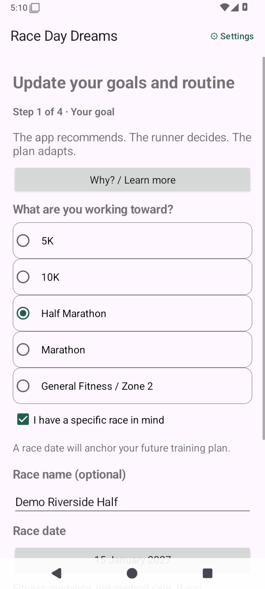
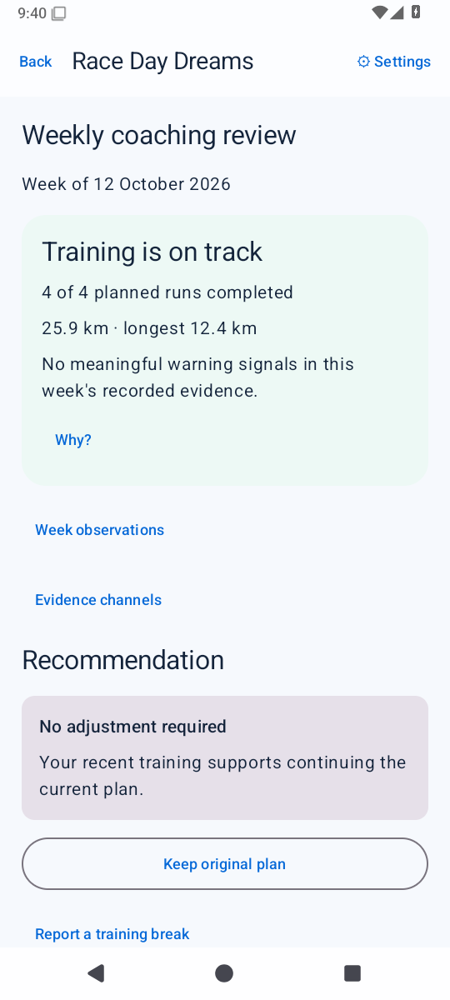
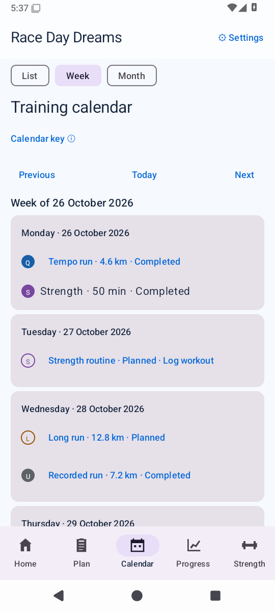
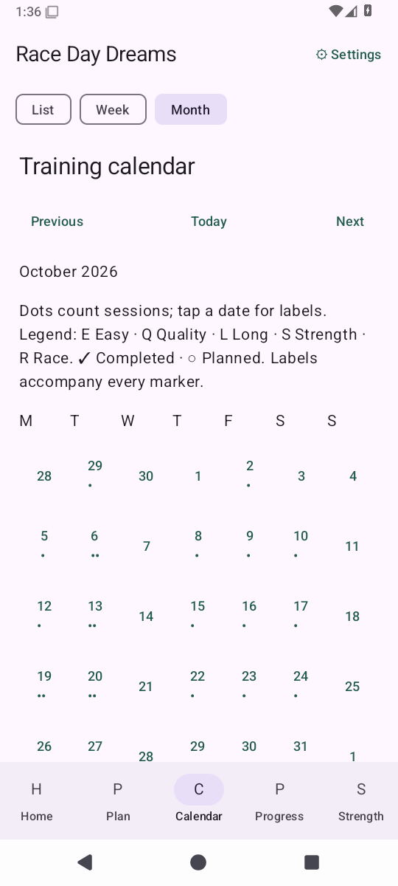
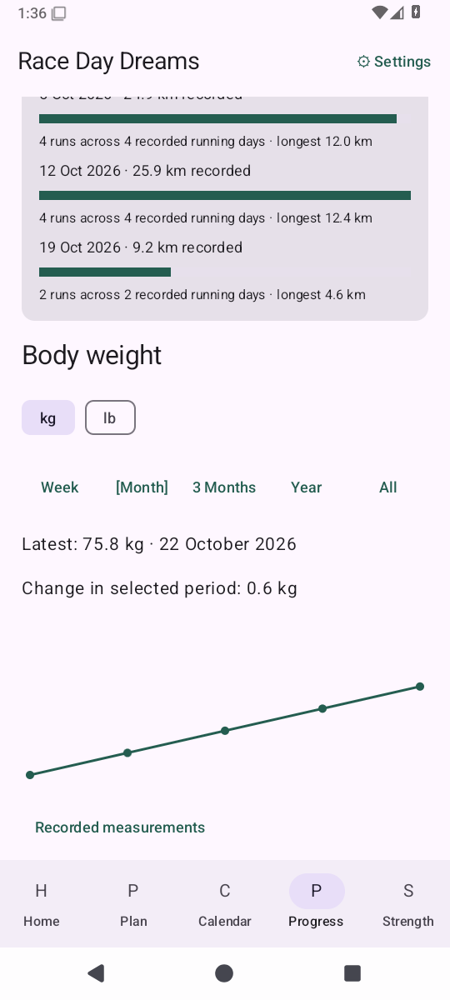
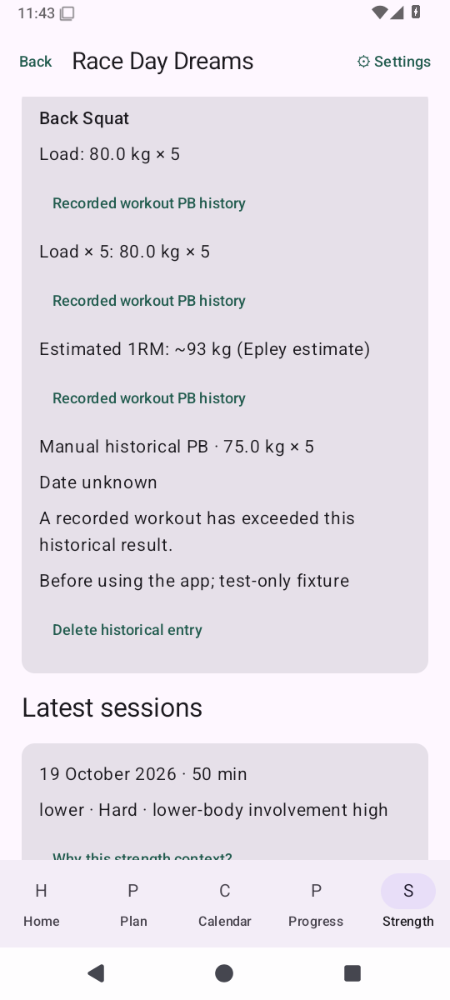
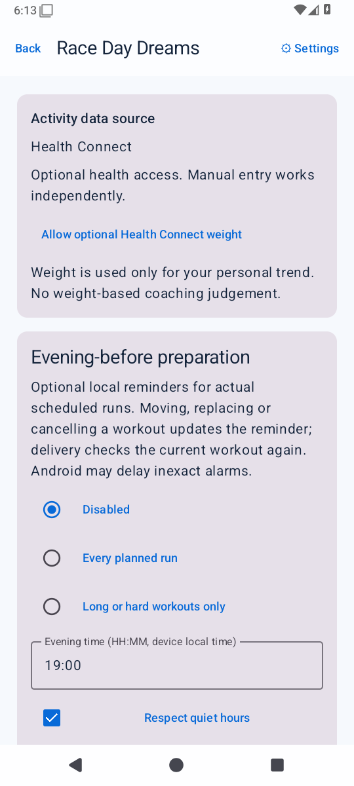

# Race Day Dreams

A free, open-source, account-free Android running companion.

**The app recommends. The runner decides. The plan adapts.**

The app works locally and without Health Connect. It has no Internet permission,
advertising, analytics, subscriptions, backend or LLM dependency.

## 0.5.0-test1 — implementation in verification

Strength and Progress use summary dashboards with dedicated detail screens. The
local catalogue has 174 canonical exercises, live name/alias search, favourites,
recents and hide/archive choices. Sets and PBs support repetitions, duration and
distance without invented reps. Twenty-five priority movements have original
schematic guides and local technique instructions.

Optional original six-week gym blocks support 1–6 days, equipment/time constraints,
experience, goals and running/strength priority. Versions retain old prescriptions;
moves, skips and reductions require runner choice. Actual workouts stay separate.
Progression advice uses actual sets and effort rather than weekly automatic loading.

Home reuses weekly evidence in “How am I doing?”. Run detail offers explainable
comparison; planned workouts show contextual briefings and one-off-move warnings.
Existing Calendar, running coaching, Health Connect, shoes, weight, reminders and
local backups remain supported. Direct Samsung scaffolding and its setting are
removed; legacy preferences normalize without deleting imported history.

See [feature status](DEVELOPMENT_PLAN.md), [programming rules](docs/STRENGTH_PROGRAMMING.md),
[training engine](TRAINING_ENGINE.md) and [phone checks](TEST_BUILD.md).
Actual build/CI results are recorded in [VERIFICATION.md](VERIFICATION.md).

## Install the test APK

Use a successful [GitHub Actions run](https://github.com/mmwiza1/Race-day-dreams/actions)
for the intended main commit. Its API-35 artifact contains
`Race-Day-Dreams-0.5.0-test1-debug.apk`. Extract the ZIP and install the APK.
GitHub artifact downloads require GitHub sign-in; the app requires no account.
Export a local backup before upgrading. [VERIFICATION.md](VERIFICATION.md) records
actual CI and merge results; an open PR is not evidence of a successful APK.

## App Preview

Screenshots are generated from the current Race Day Dreams build using
instrumentation-only demo data. They are real emulator renders, not UI mockups.
Canonical API-35 images and their source fingerprint are in
[docs/screenshots](docs/screenshots). Capture automation commits images only
after all three API jobs pass; see [SCREENSHOTS.md](docs/SCREENSHOTS.md).

| Home | Training plan | Workout detail |
| --- | --- | --- |
|  |  |  |

| Feedback | Progress | Optional strength |
| --- | --- | --- |
|  |  |  |

| Setup | Weekly review | Calendar week | Calendar month |
| --- | --- | --- | --- |
|  |  |  |  |

| Body weight | Strength records | Health settings |
| --- | --- | --- |
|  |  |  |

## Build and tests

Use JDK 17 or 21, Android SDK 36 and Android Studio with Kotlin 2.0 support.
The minimum Android version is API 28. Gradle 8.11.1 / AGP 8.9.2 are pinned.
Set `ANDROID_HOME` or an untracked `local.properties` with your SDK directory.

```sh
./gradlew :domain:check :app:assembleDebug :app:lintDebug :app:assembleDebugAndroidTest
./gradlew :app:connectedDebugAndroidTest
```

The first Android build needs dependency downloads. Pure Java domain tests and
actual schema-DDL checks can also run offline:

```sh
sh scripts/test-domain.sh
python3 scripts/test-schema.py
```

GitHub Actions builds, lints and runs the Android tests on API 28, API 35 and API 36.
Each job uploads a debug APK and device-test report. Exact verified results and
remaining manual checks are recorded in [VERIFICATION.md](VERIFICATION.md).

## Contributing and licensing

Keep calculations independent of Android UI. Preserve planned and actual data,
source identity and runner decisions. No commercial training schedules or GPL
source are incorporated. Original code is [MIT](LICENSE); incorporated libraries
and engineering references are tracked in [THIRD_PARTY.md](THIRD_PARTY.md).

Read [ARCHITECTURE.md](ARCHITECTURE.md), [HEALTH_CONNECT.md](HEALTH_CONNECT.md),
[TRAINING_ENGINE.md](TRAINING_ENGINE.md), [PRIVACY.md](PRIVACY.md),
[TRAINING_SAFETY.md](TRAINING_SAFETY.md), and
[LICENCES_AND_ATTRIBUTION.md](LICENCES_AND_ATTRIBUTION.md).
