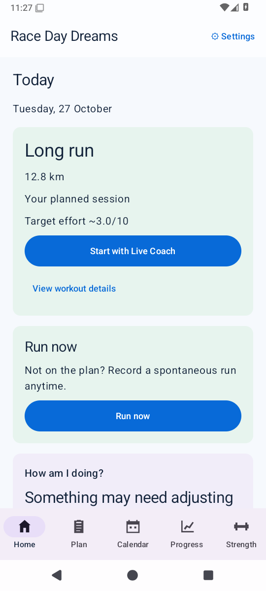
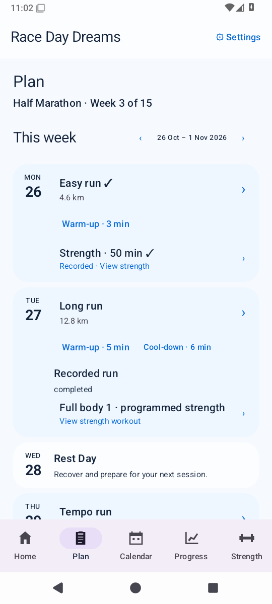
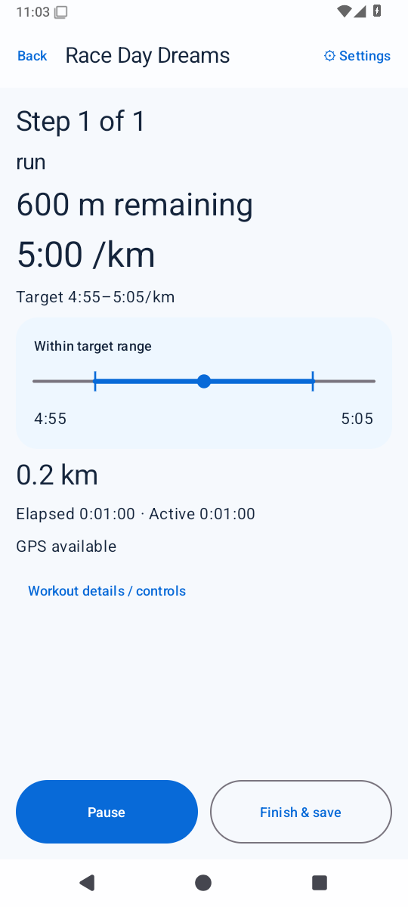
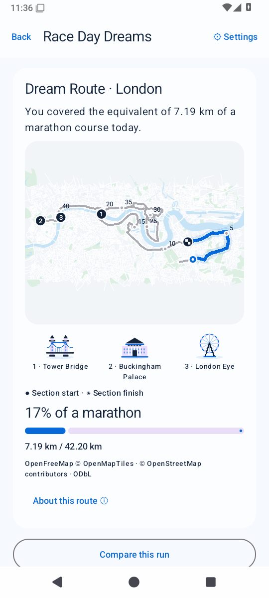
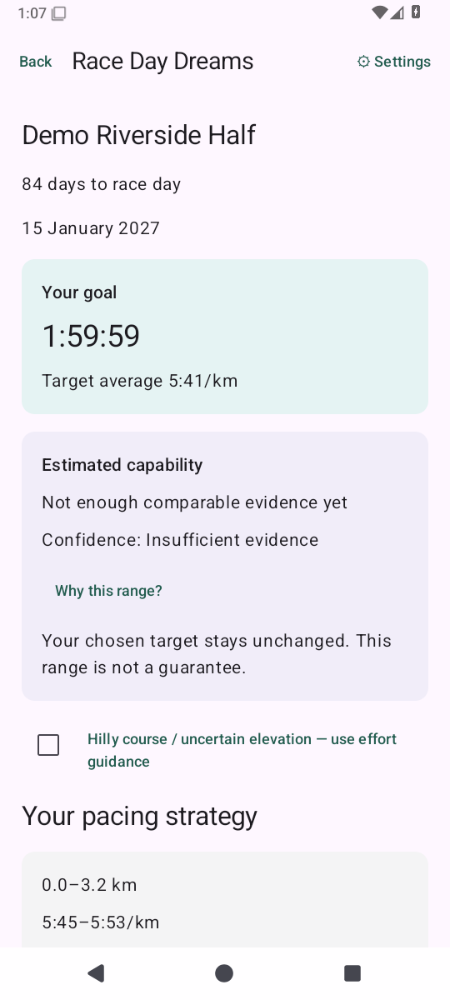
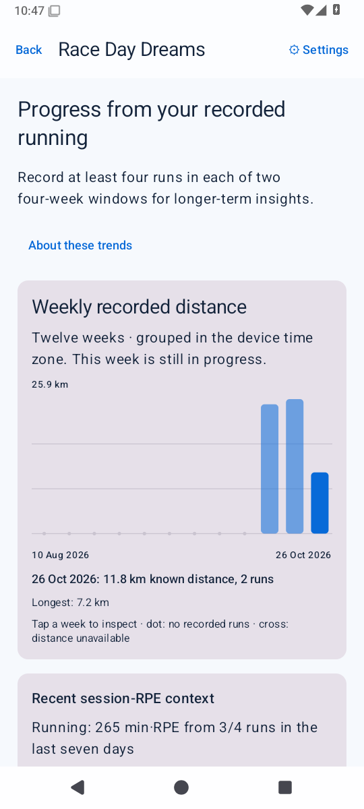
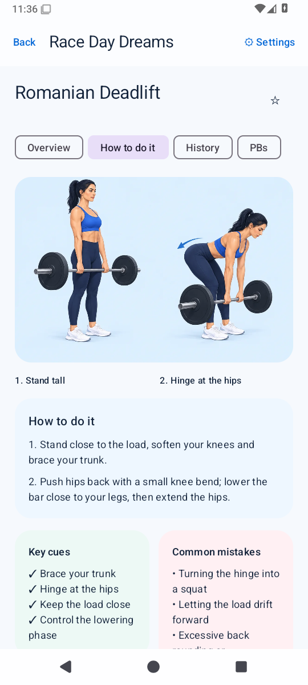
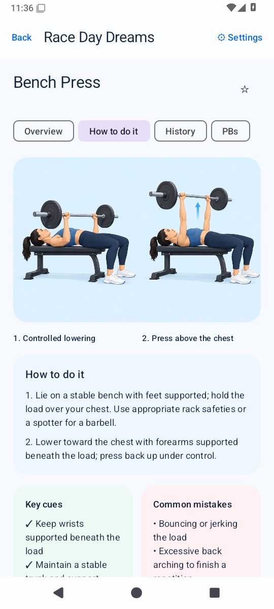
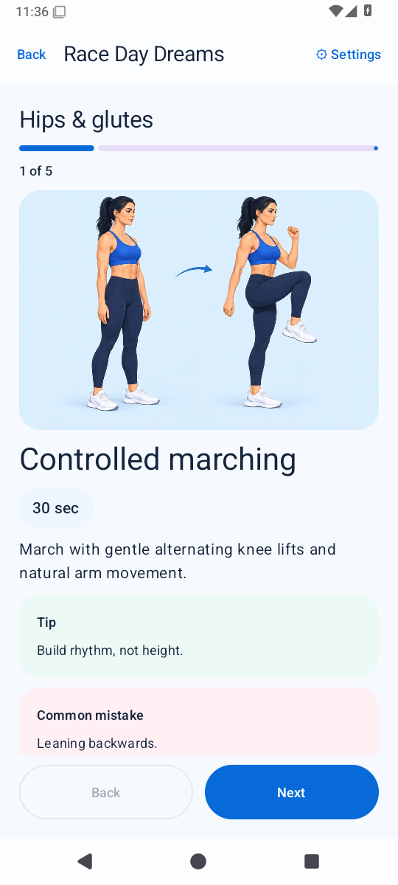
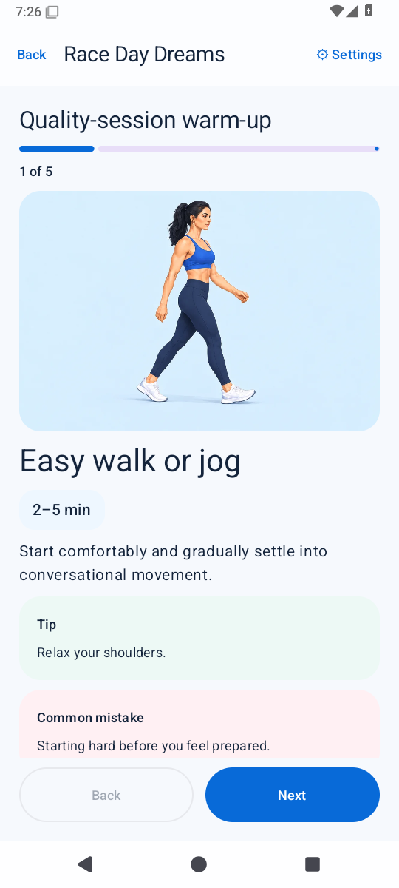

# Race Day Dreams

A free, open-source, account-free Android running companion.

**The app recommends. The runner decides. The plan adapts.**

The app works locally and without Health Connect. It has no Internet permission,
advertising, analytics, subscriptions, backend or LLM dependency.

## 0.8.2-test1 — Premium Dream Routes

Dream Routes now pair original illustrated city panoramas with the full geographic
course, a prominent blue equivalent section, clear progress and illustrated landmark
cards. London, Berlin, Paris, Tokyo and New York share the same travel-inspired design.
The accepted engine is preserved: annual Marathon de Paris 2026, stable saved assignments
and offsets, exact equivalent-distance interpolation and local backups. All artwork works
offline; no format, runtime dependency or permission changes are required. The 20 bundled
WebPs total 1,472,726 bytes. Fresh canonical captures and source verification cover all
five cities, dark mode and 200% text; see the recorded visual review and verification.
See [0.8.2 release notes](docs/RELEASE_0_8_2.md) and [Dream Routes](docs/DREAM_ROUTES.md).

Today, Run Now, one native recorder, custom/repeated workouts, Live Coach and race
preparation retain their existing behaviour. Spontaneous runs stay independent unless
you explicitly associate them with a plan.

Strength and Progress use summary dashboards with dedicated detail screens. The
local catalogue has 174 canonical exercises, live name/alias search, favourites,
recents and hide/archive choices. Sets and PBs support repetitions, duration and
distance without invented reps. Every canonical exercise has original illustrated guidance, movement-specific
instructions, cues, mistakes and accessible descriptions. All174 entries are checked
by strict catalogue and packaged-resource tests; assets work offline.

Optional original six-week gym blocks support 1–6 days, equipment/time constraints,
experience, goals and running/strength priority. Versions retain old prescriptions;
moves, skips and reductions require runner choice. Actual workouts stay separate.
Progression advice uses actual sets and effort rather than weekly automatic loading.

Home reuses weekly evidence in “How am I doing?”. Run detail offers explainable
comparison; planned workouts show contextual briefings and one-off-move warnings.
Existing Calendar, running coaching, Health Connect, shoes, weight, reminders and
local backups remain supported. Direct Samsung scaffolding and its setting are
removed; legacy preferences normalize without deleting imported history.

See [feature status](DEVELOPMENT_PLAN.md), [programming rules](docs/STRENGTH_PROGRAMMING.md),
[training engine](TRAINING_ENGINE.md) and [phone checks](TEST_BUILD.md).
Actual build/CI results are recorded in [VERIFICATION.md](VERIFICATION.md).

## Install the test APK

[Latest Development Build](https://github.com/mmwiza1/Race-day-dreams/releases/tag/development)
is the rolling prerelease download produced only after the main workflow passes.
The download follows verified main; its release notes identify the exact commit and
API-35 package. Publication waits for the full API 28/35/36 matrix and canonical checks.
No permanent stable release is created by merging this test update.

These are **debug-signed test APKs**, not Play Store production packages. Actions
artifacts for the verified 0.8.2 commit are named
`Race-Day-Dreams-0.8.2-test1-debug-api-35` and contain
`Race-Day-Dreams-0.8.2-test1-debug.apk`. The rolling release uses
`Race-Day-Dreams-0.8.2-test1.apk` after publication. Verify the intended commit in
[VERIFICATION.md](VERIFICATION.md), and export a complete local backup before upgrading.
Debug keys can differ between clean CI runners; reinstall may require backup/restore.
GitHub artifact downloads require GitHub sign-in; the app requires no account.

## App Preview

Screenshots are real emulator renders of production UI with instrumentation-only demo
data, not UI mockups. The active 0.9 development checkpoint refreshed these captures
after all three supported APIs passed 270 instrumentation tests each. The actual Home,
Strength-first Home light/dark/200% and Paris captures were opened and reviewed. Full Strength
Engine 2.0 remains in development; the rolling main download above still follows the
last complete merged release. Strength-first Home captures are also available in the
canonical directory, including dark mode and 200% text.
Canonical API-35 images and their source fingerprint are in
[docs/screenshots](docs/screenshots). Capture automation commits images only
after all three API jobs pass; see [SCREENSHOTS.md](docs/SCREENSHOTS.md).

| Today | Weekly Plan | Live Coach | Dream Route |
| --- | --- | --- | --- |
|  |  |  |  |

| Race preparation | Training trends | Romanian Deadlift | Bench Press |
| --- | --- | --- | --- |
|  |  |  |  |

The route is drawn from retained observations on an offline canvas, not street tiles.
Dream Routes use versioned sourced geographic lines and original city illustrations,
not official maps or navigation. Paris uses the annual Marathon de Paris2026 street itinerary with ODbL OSM geometry. Old assignments retain their original drawings.
Physical sensor/audio behaviour still requires the Galaxy S24 checklist.

## Build and tests

Use JDK 17 or 21, Android SDK 36 and Android Studio with Kotlin 2.0 support.
The minimum Android version is API 28. Gradle 8.11.1 / AGP 8.9.2 are pinned.
Set `ANDROID_HOME` or an untracked `local.properties` with your SDK directory.

```sh
./gradlew :domain:check :app:assembleDebug :app:lintDebug :app:assembleDebugAndroidTest
./gradlew :app:connectedDebugAndroidTest
```

The first Android build needs dependency downloads. Pure Java domain tests and
actual schema-DDL checks can also run offline:

```sh
sh scripts/test-domain.sh
python3 scripts/test-schema.py
```

GitHub Actions builds, lints and runs the Android tests on API 28, API 35 and API 36.
Each job uploads a debug APK and device-test report. Exact verified results and
remaining manual checks are recorded in [VERIFICATION.md](VERIFICATION.md).

## Contributing and licensing

Keep calculations independent of Android UI. Preserve planned and actual data,
source identity and runner decisions. No commercial training schedules or GPL
source are incorporated. Original code is [MIT](LICENSE); incorporated libraries
and engineering references are tracked in [THIRD_PARTY.md](THIRD_PARTY.md).

Read [ARCHITECTURE.md](ARCHITECTURE.md), [HEALTH_CONNECT.md](HEALTH_CONNECT.md),
[TRAINING_ENGINE.md](TRAINING_ENGINE.md), [PRIVACY.md](PRIVACY.md),
[TRAINING_SAFETY.md](TRAINING_SAFETY.md), and
[LICENCES_AND_ATTRIBUTION.md](LICENCES_AND_ATTRIBUTION.md).

## Health Intelligence + Run Engine test increment (0.6.0-test1)

The current development branch adds optional personal sleep/RHR/HRV/steps context,
a minimal foreground phone-GNSS recorder, real timestamped samples and interpolated
splits, manual pause and optional conservative auto-pause, BLE HR/step-sensor cadence,
GPX import/export and explicit Health Connect run-total write-back. No online map,
voice coaching or account is required. See [recording and backup details](docs/RUN_ENGINE.md).

Use both the normal app backup and **Back up raw recordings** ZIP before reinstall:
standard JSON alone does not retain raw coordinates/events. Follow [phone checks](TEST_BUILD.md).
Only a successful intended-commit Actions artifact is a verified installable build;
0.6 artifacts are named `Race-Day-Dreams-0.6.0-test1-debug-api-35`. Preview images are
regenerated by real instrumentation; no live GNSS/health evidence is fabricated.

## Live Coach and race preparation (0.7.0-test1)

Start a preserved planned workout with Live Coach. The same foreground recorder owns
GPS, elapsed/active time and pause state for free, planned and race runs. Ordered
distance/time segments transition deterministically, with optional offline Android
speech and haptics. Pace guidance needs sustained smoothed evidence; it is suppressed
while paused, unreliable, transitioning or using hilly effort-based race strategy.
Finishing opens actual history; original prescriptions and per-step evidence remain.

Race Day keeps your target distinct from an explainable estimated range. Predictions
require multiple recent independent performances and distance-appropriate endurance.
Official chip time can be entered separately from GPS totals. No goal is changed.

Short original warm-ups/cool-downs and five mobility routines have text instructions
and original bundled exercise illustrations. Completion is optional support, never a
calendar workout or training-load/adherence target. Dream Routes preserve a stable
marathon-equivalent segment of a versioned geographic course, with original decorative
city artwork. They are independent visualisations, not official maps or navigation;
no physical-location claim is made.

Home → Record a run → Route files now offers a **complete backup** ZIP containing
validated app JSON and checksummed raw recordings, restored in one SQLite transaction.
Legacy JSON and raw archive readers remain supported. Export requires finishing or
recovering any unfinished run; an emergency raw archive remains available separately.
See TEST_BUILD.md and docs/LIVE_COACH.md for physical-device checks and explicit limits.

| Live workout | Race preparation | Optional mobility |
| --- | --- | --- |
|  |  |  |

| Attached warm-up | Offline marathon equivalent |
| --- | --- |
|  |  |

The live-workout capture uses deterministic instrumentation-only engine input, not a
claim of physical GPS testing. Dream city artwork is atmospheric; equivalent sections
use the preserved geographic course rather than claiming the runner visited that city.
