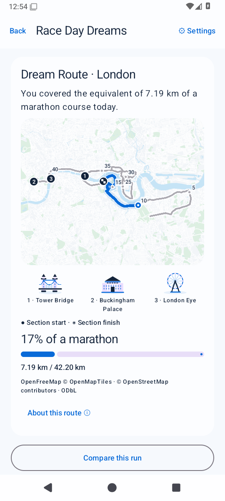

# Race Day Dreams

A free, open-source, account-free Android running companion.

**The app recommends. The runner decides. The plan adapts.**

The app works locally and without Health Connect. It has no Internet permission,
advertising, analytics, subscriptions, backend or LLM dependency.

## 0.8.1-test1 — test release in preparation

Today puts your planned session and Run Now first. Free runs, quick distance/time
choices, custom structured workouts and repeat favourites all use one native recorder.
Spontaneous runs stay independent unless you explicitly associate them with a plan.
Offline route traces, evidence-backed Route Story, five geographic Dream Routes with
original street/water/green-space styling and optional routines extend the preserved
Live Coach and race preparation foundations. No map tiles are downloaded by the app.
See [0.8.1 release notes](docs/RELEASE_0_8_1.md) for current refinements and limitations.

Strength and Progress use summary dashboards with dedicated detail screens. The
local catalogue has 174 canonical exercises, live name/alias search, favourites,
recents and hide/archive choices. Sets and PBs support repetitions, duration and
distance without invented reps. Every canonical exercise has original illustrated guidance, movement-specific
instructions, cues, mistakes and accessible descriptions. All174 entries are checked
by strict catalogue and packaged-resource tests; assets work offline.

Optional original six-week gym blocks support 1–6 days, equipment/time constraints,
experience, goals and running/strength priority. Versions retain old prescriptions;
moves, skips and reductions require runner choice. Actual workouts stay separate.
Progression advice uses actual sets and effort rather than weekly automatic loading.

Home reuses weekly evidence in “How am I doing?”. Run detail offers explainable
comparison; planned workouts show contextual briefings and one-off-move warnings.
Existing Calendar, running coaching, Health Connect, shoes, weight, reminders and
local backups remain supported. Direct Samsung scaffolding and its setting are
removed; legacy preferences normalize without deleting imported history.

See [feature status](DEVELOPMENT_PLAN.md), [programming rules](docs/STRENGTH_PROGRAMMING.md),
[training engine](TRAINING_ENGINE.md) and [phone checks](TEST_BUILD.md).
Actual build/CI results are recorded in [VERIFICATION.md](VERIFICATION.md).

## Install the test APK

[GitHub Releases](https://github.com/mmwiza1/Race-day-dreams/releases) is the download
location for verified tagged test releases and the rolling development build once
published by the green main/tag workflow. The0.8.1 refinement PR remains draft pending
final visual acceptance; no0.8.1 permanent release is claimed yet. These APKs are
debug signed test builds, not Play Store production packages.

Use a successful [GitHub Actions run](https://github.com/mmwiza1/Race-day-dreams/actions)
for the intended main commit. Its API-35 artifact contains
`Race-Day-Dreams-0.8.1-test1-debug.apk`. Extract the ZIP and install the APK.
GitHub artifact downloads require GitHub sign-in; the app requires no account.
Export a local backup before upgrading. [VERIFICATION.md](VERIFICATION.md) records
actual CI and merge results; an open PR is not evidence of a successful APK.

## App Preview

Screenshots are generated from the current Race Day Dreams build using
instrumentation-only demo data. They are real emulator renders, not UI mockups.
Canonical API-35 images and their source fingerprint are in
[docs/screenshots](docs/screenshots). Capture automation commits images only
after all three API jobs pass; see [SCREENSHOTS.md](docs/SCREENSHOTS.md).

| Today | Weekly Plan | Live Coach | Dream Route |
| --- | --- | --- | --- |
|  |  |  |  |

| Race preparation | Training trends | Romanian Deadlift | Bench Press |
| --- | --- | --- | --- |
|  |  |  |  |

The route is drawn from retained observations on an offline canvas, not street tiles.
Dream Routes use versioned sourced geographic lines and original city illustrations,
not official maps or navigation. Paris uses the annual Marathon de Paris2026 street itinerary with ODbL OSM geometry. Old assignments retain their original drawings.
Physical sensor/audio behaviour still requires the Galaxy S24 checklist.

## Build and tests

Use JDK 17 or 21, Android SDK 36 and Android Studio with Kotlin 2.0 support.
The minimum Android version is API 28. Gradle 8.11.1 / AGP 8.9.2 are pinned.
Set `ANDROID_HOME` or an untracked `local.properties` with your SDK directory.

```sh
./gradlew :domain:check :app:assembleDebug :app:lintDebug :app:assembleDebugAndroidTest
./gradlew :app:connectedDebugAndroidTest
```

The first Android build needs dependency downloads. Pure Java domain tests and
actual schema-DDL checks can also run offline:

```sh
sh scripts/test-domain.sh
python3 scripts/test-schema.py
```

GitHub Actions builds, lints and runs the Android tests on API 28, API 35 and API 36.
Each job uploads a debug APK and device-test report. Exact verified results and
remaining manual checks are recorded in [VERIFICATION.md](VERIFICATION.md).

## Contributing and licensing

Keep calculations independent of Android UI. Preserve planned and actual data,
source identity and runner decisions. No commercial training schedules or GPL
source are incorporated. Original code is [MIT](LICENSE); incorporated libraries
and engineering references are tracked in [THIRD_PARTY.md](THIRD_PARTY.md).

Read [ARCHITECTURE.md](ARCHITECTURE.md), [HEALTH_CONNECT.md](HEALTH_CONNECT.md),
[TRAINING_ENGINE.md](TRAINING_ENGINE.md), [PRIVACY.md](PRIVACY.md),
[TRAINING_SAFETY.md](TRAINING_SAFETY.md), and
[LICENCES_AND_ATTRIBUTION.md](LICENCES_AND_ATTRIBUTION.md).

## Health Intelligence + Run Engine test increment (0.6.0-test1)

The current development branch adds optional personal sleep/RHR/HRV/steps context,
a minimal foreground phone-GNSS recorder, real timestamped samples and interpolated
splits, manual pause and optional conservative auto-pause, BLE HR/step-sensor cadence,
GPX import/export and explicit Health Connect run-total write-back. No online map,
voice coaching or account is required. See [recording and backup details](docs/RUN_ENGINE.md).

Use both the normal app backup and **Back up raw recordings** ZIP before reinstall:
standard JSON alone does not retain raw coordinates/events. Follow [phone checks](TEST_BUILD.md).
Only a successful intended-commit Actions artifact is a verified installable build;
0.6 artifacts are named `Race-Day-Dreams-0.6.0-test1-debug-api-35`. Preview images are
regenerated by real instrumentation; no live GNSS/health evidence is fabricated.

## Live Coach and race preparation (0.7.0-test1)

Start a preserved planned workout with Live Coach. The same foreground recorder owns
GPS, elapsed/active time and pause state for free, planned and race runs. Ordered
distance/time segments transition deterministically, with optional offline Android
speech and haptics. Pace guidance needs sustained smoothed evidence; it is suppressed
while paused, unreliable, transitioning or using hilly effort-based race strategy.
Finishing opens actual history; original prescriptions and per-step evidence remain.

Race Day keeps your target distinct from an explainable estimated range. Predictions
require multiple recent independent performances and distance-appropriate endurance.
Official chip time can be entered separately from GPS totals. No goal is changed.

Short original warm-ups/cool-downs and five mobility routines have text instructions
and lightweight original line figures. Completion is optional support, never a calendar
workout or training-load/adherence target. Dream Routes store a stable random
marathon-equivalent segment of one of five **original city-inspired schematics**. They
are not verified/official course geometry or navigation; no location claim is made.

Home → Record a run → Route files now offers a **complete backup** ZIP containing
validated app JSON and checksummed raw recordings, restored in one SQLite transaction.
Legacy JSON and raw archive readers remain supported. Export requires finishing or
recovering any unfinished run; an emergency raw archive remains available separately.
See TEST_BUILD.md and docs/LIVE_COACH.md for physical-device checks and explicit limits.

| Live workout | Race preparation | Optional mobility |
| --- | --- | --- |
|  |  |  |

| Attached warm-up | Offline marathon equivalent |
| --- | --- |
|  |  |

The live-workout capture uses deterministic instrumentation-only engine input, not a
claim of physical GPS testing. Dream drawings are original schematics, not real maps.
