# Race Day Dreams

### Your free, open-source running and strength coach.

Train for a **5K, 10K, half marathon or marathon**, follow a strength programme, or combine
running and gym training. Get practical suggestions, understand why they were made, and choose
what works for you.

**Free and open source · No account · No adverts · No subscriptions · Offline-first · Optional Health Connect**

**The app recommends. The athlete decides. The plan adapts.**

## Download for Android

**[Download the latest verified Android test build](https://github.com/mmwiza1/Race-day-dreams/releases/download/development/Race-Day-Dreams-latest-test.apk)**

[View the features](#features) · [Explore screenshots](#screenshots) · [Installation instructions](#installation)

Development/test build for **Android 9 (API 28) or newer**, not a Play Store or stable production release.
[Checksum](https://github.com/mmwiza1/Race-day-dreams/releases/download/development/Race-Day-Dreams-latest-test.apk.sha256) · [Version, release notes and versioned APK](https://github.com/mmwiza1/Race-day-dreams/releases/tag/development)

The download always points to the last verified development build. It may lag behind work in
progress. No account or Internet connection is required to use the app.

## Features

Screenshots below are genuine production screens using **synthetic demonstration records**,
not real athlete results or promotional mock-ups. Tap any image for its full-resolution original.
Device colours, light/dark themes and large text are supported.

### Running Coach

See today's session, follow a plan and record your run with clear distance, time, pace and GPS
status. Build towards your chosen race distance with guidance that leaves decisions to you.

<a href="docs/screenshots/home-material-brand-light.png">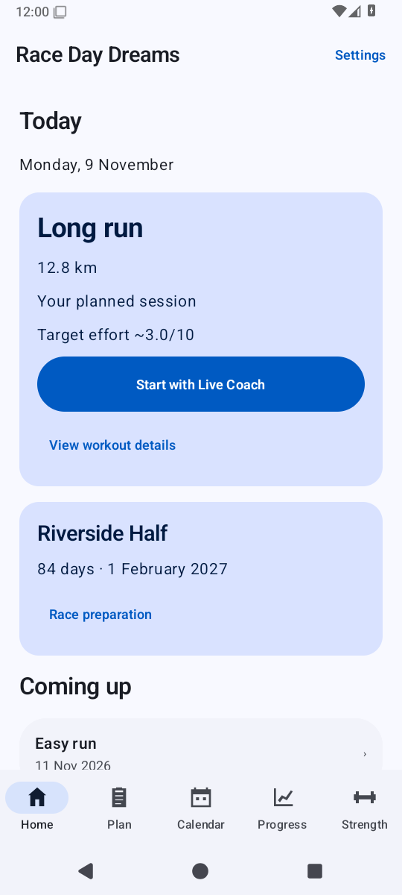</a> <a href="docs/screenshots/live-refined-statistics-dark.png">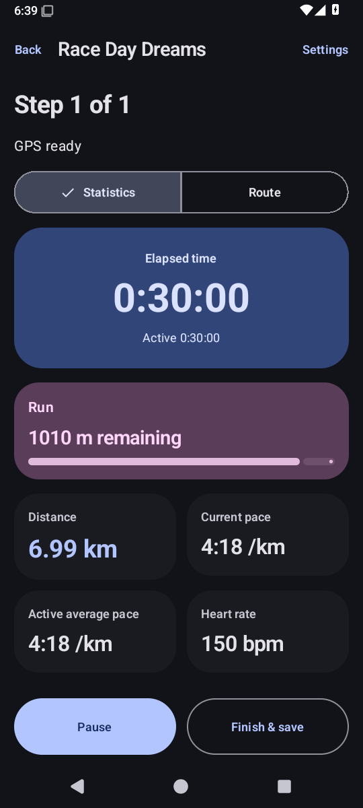</a>

**[Download for Android](https://github.com/mmwiza1/Race-day-dreams/releases/download/development/Race-Day-Dreams-latest-test.apk)** · [Installation](#installation)

Review the week ahead and the route you actually recorded. Route outlines work offline; they are not street-map navigation.

<a href="docs/screenshots/training-plan.png">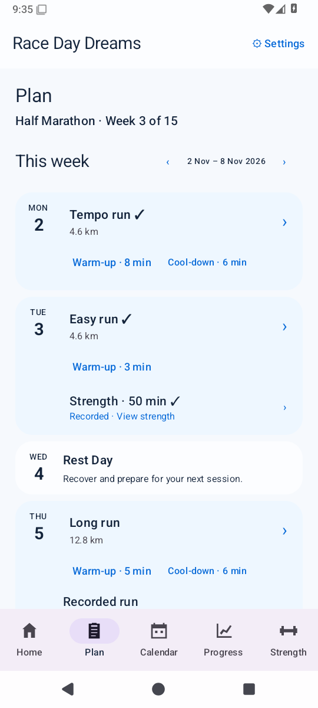</a> <a href="docs/screenshots/live-refined-route.png">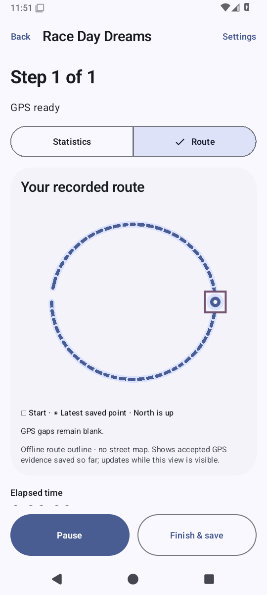</a>

**[Download for Android](https://github.com/mmwiza1/Race-day-dreams/releases/download/development/Race-Day-Dreams-latest-test.apk)** · [Installation](#installation)

### Strength and Gym

Use Strength on its own or alongside running. Start from a programme or Gym Now, browse
illustrated exercises and review each session before training.

<a href="docs/screenshots/strength-home.png">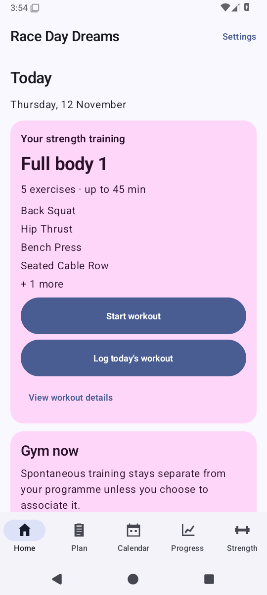</a> <a href="docs/screenshots/exercise-library-refined-dark.png">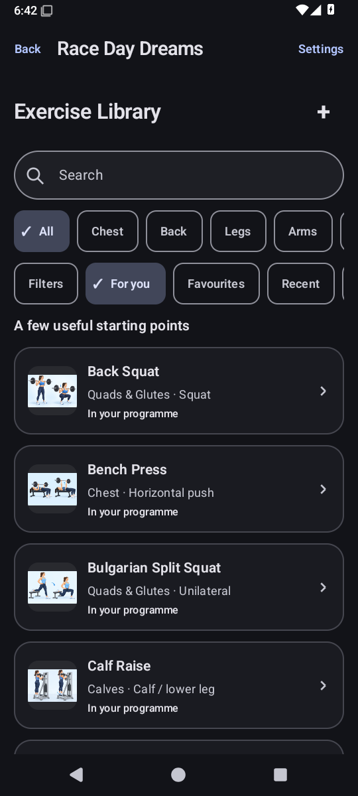</a>

**[Download for Android](https://github.com/mmwiza1/Race-day-dreams/releases/download/development/Race-Day-Dreams-latest-test.apk)** · [Installation](#installation)

Optional rest timers, warm-up ideas and grouped exercises (supersets) support your workout. Record the sets you actually complete; progression suggestions and programme changes remain your choice.

<a href="docs/screenshots/gym-now.png">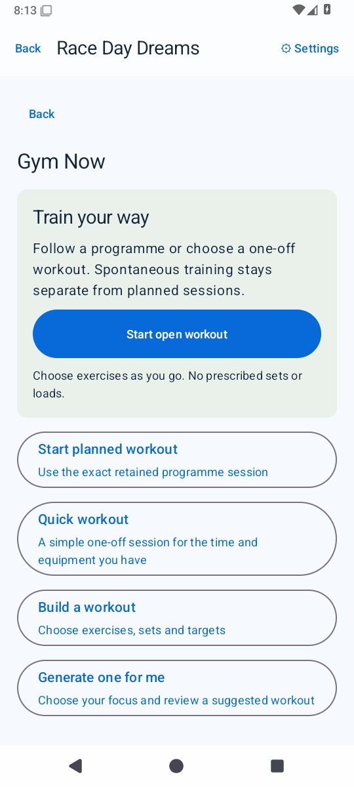</a> <a href="docs/screenshots/strength-generated-preview.png">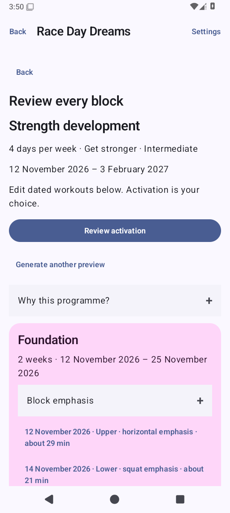</a>

**[Download for Android](https://github.com/mmwiza1/Race-day-dreams/releases/download/development/Race-Day-Dreams-latest-test.apk)** · [Installation](#installation)

### Progress and Performance

Review running trends, recorded personal bests, strength training and workout history.
Recorded results stay distinct from estimates. Missing measurements are shown honestly.

<a href="docs/screenshots/running-trends-distance.png">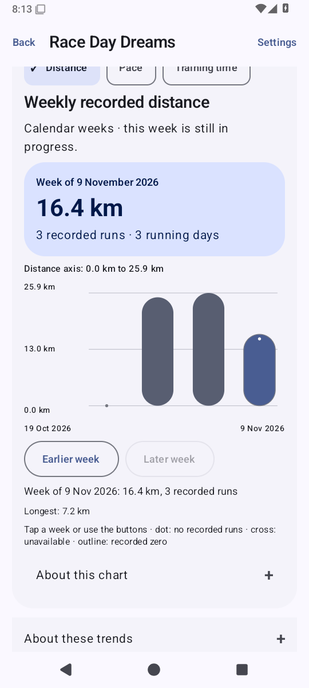</a> <a href="docs/screenshots/running-records-refined.png">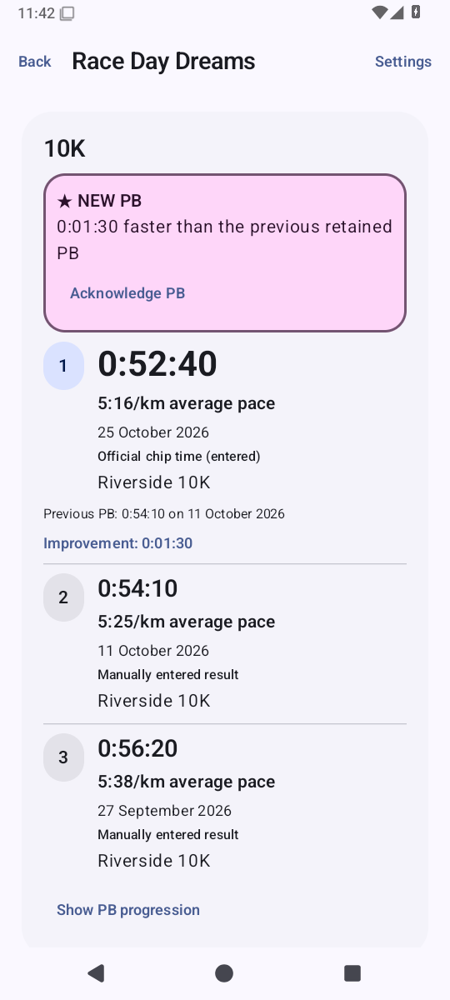</a>

**[Download for Android](https://github.com/mmwiza1/Race-day-dreams/releases/download/development/Race-Day-Dreams-latest-test.apk)** · [Installation](#installation)

<a href="docs/screenshots/strength-analytics.png">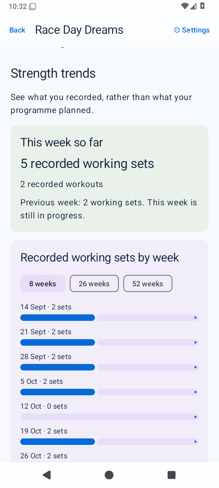</a> <a href="docs/screenshots/history.png">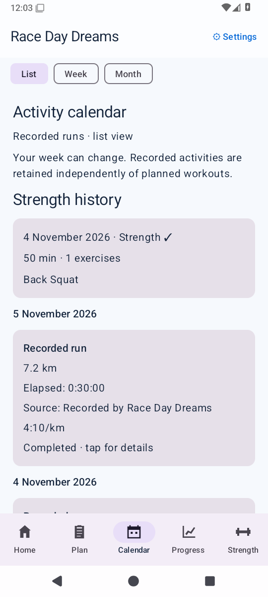</a>

**[Download for Android](https://github.com/mmwiza1/Race-day-dreams/releases/download/development/Race-Day-Dreams-latest-test.apk)** · [Installation](#installation)

### Health and Recovery

Understand optional recovery suggestions and choose whether to change your training.
Health Connect is optional; the app works without a connected provider.

<a href="docs/screenshots/training-recovery.png">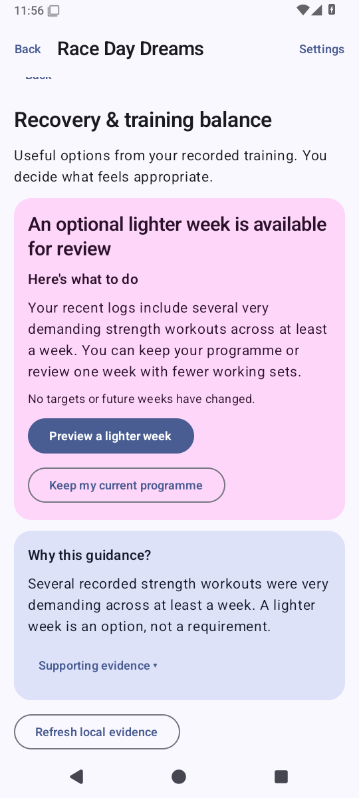</a> <a href="docs/screenshots/body-measurements.png">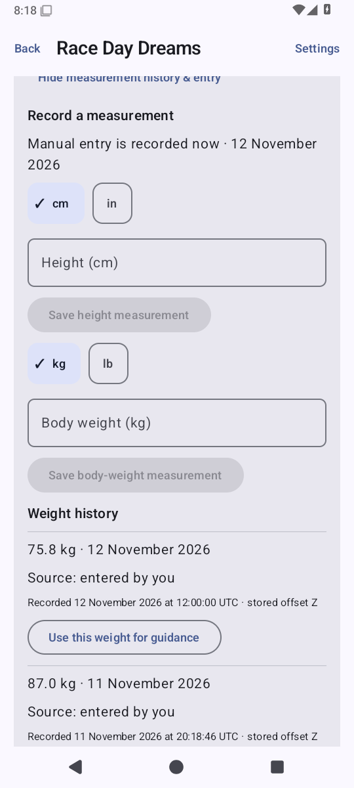</a>

**[Download for Android](https://github.com/mmwiza1/Race-day-dreams/releases/download/development/Race-Day-Dreams-latest-test.apk)** · [Installation](#installation)

Optional protein guidance gives a general daily range based on a chosen weight and training focus. It is not a medical prescription, calorie tracker or weight-loss programme.

<a href="docs/screenshots/body-protein-dark.png">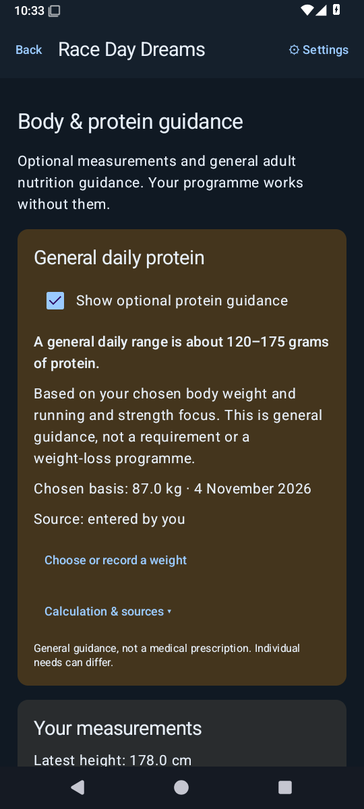</a>

**[Download for Android](https://github.com/mmwiza1/Race-day-dreams/releases/download/development/Race-Day-Dreams-latest-test.apk)** · [Installation](#installation)

### Privacy and Data Ownership

Your training records stay on your device. No account, advertising, analytics, subscriptions
or backend. Back up and restore your history, and choose how much detailed GPS/sensor data to
keep. Cleanup requires review and confirmation; workout summaries and personal bests remain.

<a href="docs/screenshots/storage-management.png">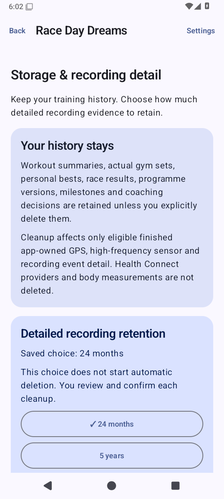</a>

**[Download for Android](https://github.com/mmwiza1/Race-day-dreams/releases/download/development/Race-Day-Dreams-latest-test.apk)** · [Installation](#installation)

## Installation

1. Download the APK above, then open it on your Android phone.
2. If Android asks, allow **Install unknown apps** for the browser or file manager you used.
3. Open Race Day Dreams and choose Running, Strength or both. Health permissions are optional.
4. Existing testers: make a **complete backup before upgrading**. Debug-signing keys may differ
   between builds. If Android reports a signing conflict, verify your backup before uninstalling,
   then install and restore it. Uninstalling without a usable backup can lose local data.

Verify the APK with its linked SHA-256 checksum if desired. The release page shows the exact
version, source commit, verified CI run and version-specific APK. These are development builds;
physical GPS, audio, Health Connect/BLE and OEM behaviour still need the [device checklist](TEST_BUILD.md).

## Screenshots

[Explore the full authentic app gallery](docs/screenshots) · [Screenshot sources and integrity](docs/SCREENSHOTS.md)

The gallery includes light, dark, large-text, running, gym, technique, recovery, settings and
backup views. Design references are kept separate from actual-build captures.

## For contributors and testers

- [Verification and current delivery evidence](VERIFICATION.md)
- [Architecture](ARCHITECTURE.md) · [Development plan](DEVELOPMENT_PLAN.md) · [Contributor workflow](docs/DEVELOPMENT_WORKFLOW.md)
- [Build and device testing](TEST_BUILD.md) · [Current release notes](https://github.com/mmwiza1/Race-day-dreams/releases/tag/development)
- [Privacy](PRIVACY.md) · [MIT licence](LICENSE) · [Attribution](THIRD_PARTY.md)
- [Dream Route data and licences](docs/DREAM_ROUTES.md)
- [Earlier project overview, release history, gallery and developer details](docs/README_0_12_2_ARCHIVE.md)
- [How the verified rolling download stays current](docs/GITHUB_SHOWCASE.md)

No iOS port, cloud sync, mandatory login or Internet permission is introduced by this release.
