# Race Day Dreams

### Your free, open-source running and strength coach.

Train for a **5K, 10K, half marathon or marathon**, follow a strength programme, or combine
running and gym training. Get practical suggestions, understand why they were made, and choose
what works for you.

**Free and open source · No account · No adverts · No subscriptions · Offline-first · Optional Health Connect**

**The app recommends. The athlete decides. The plan adapts.**

## Download for Android

**[Download the latest verified Android test build](https://github.com/mmwiza1/Race-day-dreams/releases/download/development/Race-Day-Dreams-latest-test.apk)**

[View the features](#features) · [Explore screenshots](#screenshots) · [Installation instructions](#installation)

Development/test build for **Android 9 (API 28) or newer**, not a Play Store or stable production release.
[Checksum](https://github.com/mmwiza1/Race-day-dreams/releases/download/development/Race-Day-Dreams-latest-test.apk.sha256) · [Version, release notes and versioned APK](https://github.com/mmwiza1/Race-day-dreams/releases/tag/development)

The download always points to the last verified development build. It may lag behind work in
progress. No account or Internet connection is required to use the app. Builds signed with the
release key can optionally check GitHub for updates in Settings › App updates; see
[Android updates](docs/ANDROID_UPDATES.md).

## iOS developer/test builds (unsigned)

For iOS developers and technically capable testers. These are **unsigned engineering builds, not
installable consumer apps** — there is no App Store or TestFlight version.

- **[iOS Simulator app (universal, unsigned)](https://github.com/mmwiza1/Race-day-dreams/releases/download/development/Race-Day-Dreams-latest-ios-simulator.zip)** ·
  [Checksum](https://github.com/mmwiza1/Race-day-dreams/releases/download/development/Race-Day-Dreams-latest-ios-simulator.zip.sha256) — run in Xcode's iOS Simulator on a Mac
- **[Unsigned iPhone arm64 app](https://github.com/mmwiza1/Race-day-dreams/releases/download/development/Race-Day-Dreams-latest-iphoneos-unsigned.zip)** ·
  [Checksum](https://github.com/mmwiza1/Race-day-dreams/releases/download/development/Race-Day-Dreams-latest-iphoneos-unsigned.zip.sha256) — needs your own Apple signing and provisioning
- **[Unsigned iPhone .ipa](https://github.com/mmwiza1/Race-day-dreams/releases/download/development/Race-Day-Dreams-latest-unsigned.ipa)** ·
  [Checksum](https://github.com/mmwiza1/Race-day-dreams/releases/download/development/Race-Day-Dreams-latest-unsigned.ipa.sha256) — the same app as an `.ipa` for sideloading tools (AltStore, Sideloadly) that re-sign it with your own Apple ID; not installable as-is
- [Build information](https://github.com/mmwiza1/Race-day-dreams/releases/download/development/Race-Day-Dreams-latest-build-info.txt) — version, source commit and SHA-256 of
  every binary. Android and iOS downloads always come from the same verified commit.

See [Build and device testing](TEST_BUILD.md) for simulator installation and re-signing notes.

## Features

Screenshots below are genuine Android emulator captures of the current app using
**synthetic demonstration records**, not real athlete results or promotional mock-ups. Tap any
image for its full-resolution original. Device colours, light/dark themes and large text are supported.

### Get Started

Choose what you want to train for. Running, strength and hybrid users each get a Today screen
built around their next session, with one clear way to start and spontaneous training one tap away.

<a href="docs/screenshots/starting-path-light.png">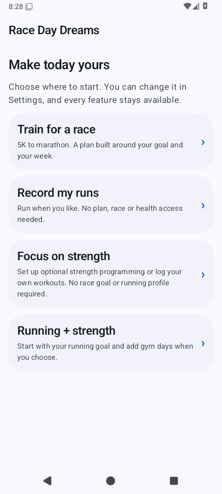</a> <a href="docs/screenshots/home.png">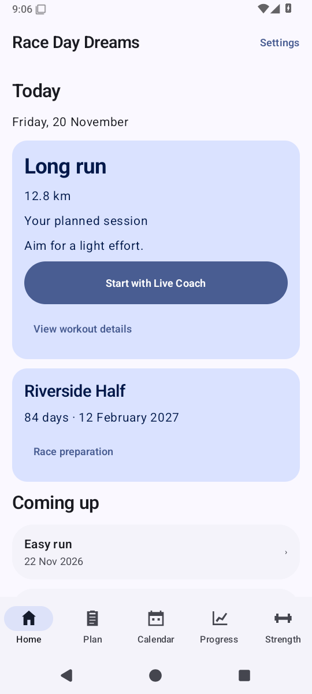</a>

### Running Coach

Follow a weekly plan towards a 5K, 10K, half marathon or marathon, then record your run with clear
distance, time, pace and GPS status. Guidance leaves every decision to you.

<a href="docs/screenshots/training-plan.png">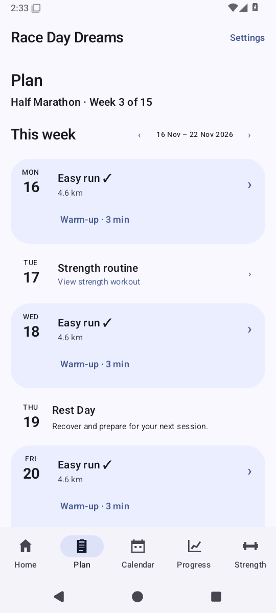</a> <a href="docs/screenshots/live-refined-statistics.png">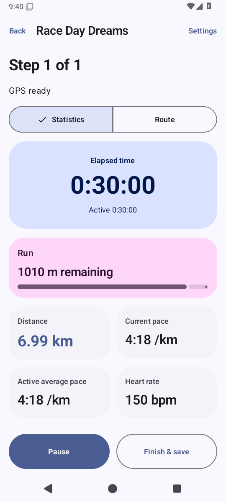</a>

### Strength and Gym

Use Strength on its own or alongside running. Start a planned or unplanned workout, build and
review programmes, and browse an illustrated exercise library. Bouldering is there for climbers
and stays out of the way for everyone else.

<a href="docs/screenshots/strength-home.png">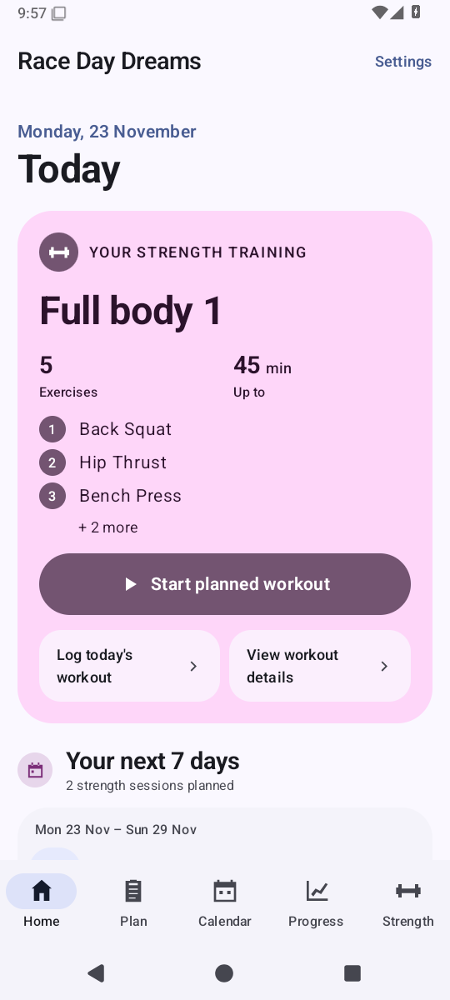</a> <a href="docs/screenshots/gym-now.png">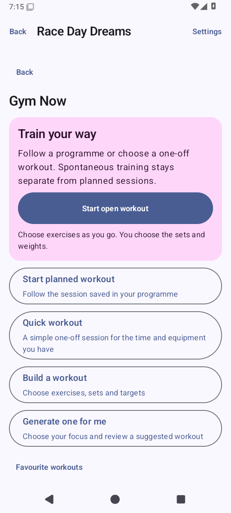</a>

<a href="docs/screenshots/strength-programme-builder.png">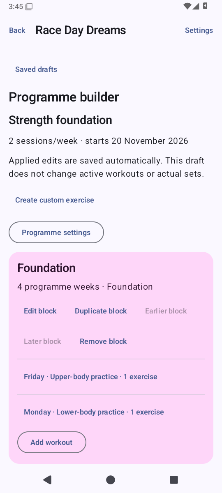</a> <a href="docs/screenshots/exercise-library-refined.png">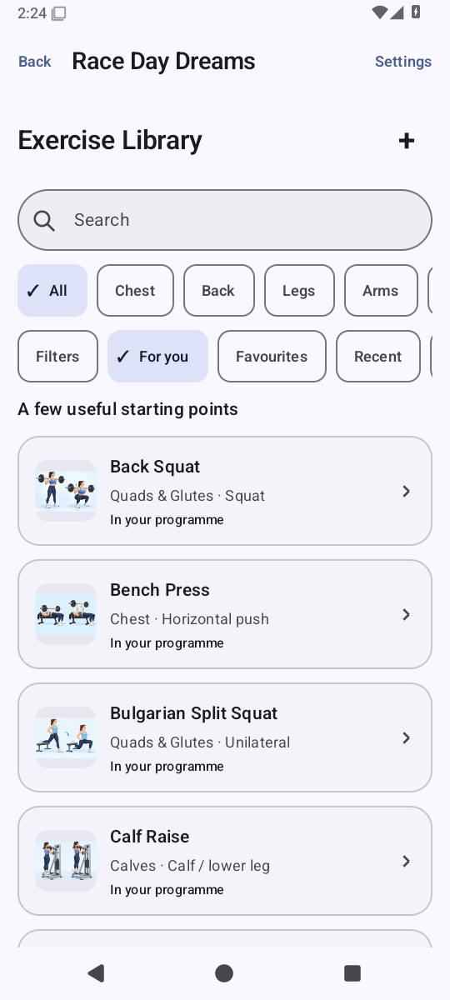</a>

<a href="docs/screenshots/bouldering-home.png">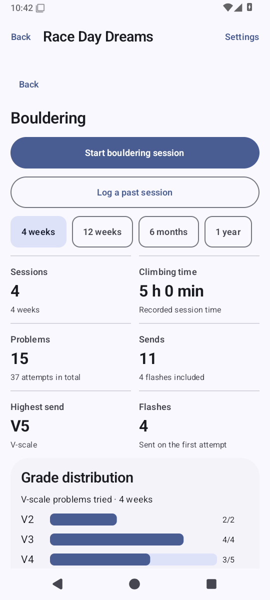</a>

### Progress and Performance

Progress follows your focus: running trends for runners, lifting first for strength athletes and
both side by side for hybrid training. Recorded results stay distinct from estimates, and averages
say how many sessions they are based on.

<a href="docs/screenshots/progress.png">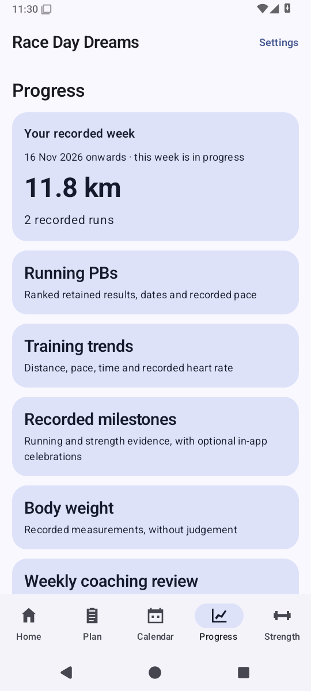</a> <a href="docs/screenshots/progress-strength-focus.png">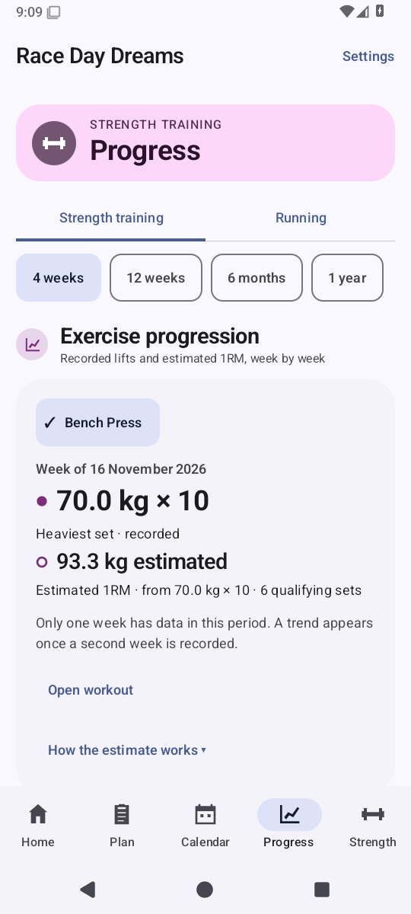</a>

### Health and Recovery

Understand optional recovery suggestions and choose whether to change your training.
Health Connect is optional; the app works without a connected provider.

<a href="docs/screenshots/training-recovery.png">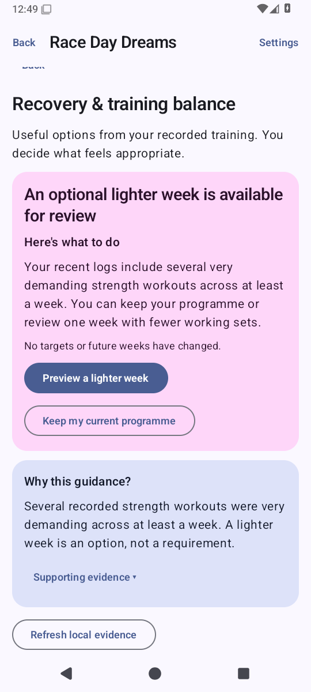</a>

### Privacy and Data Ownership

Your training records stay on your device. No account, advertising, analytics, subscriptions
or backend. Settings are grouped into clear sections, including backup and restore and how much
detailed GPS/sensor data to keep. Cleanup requires review and confirmation.

<a href="docs/screenshots/settings.png">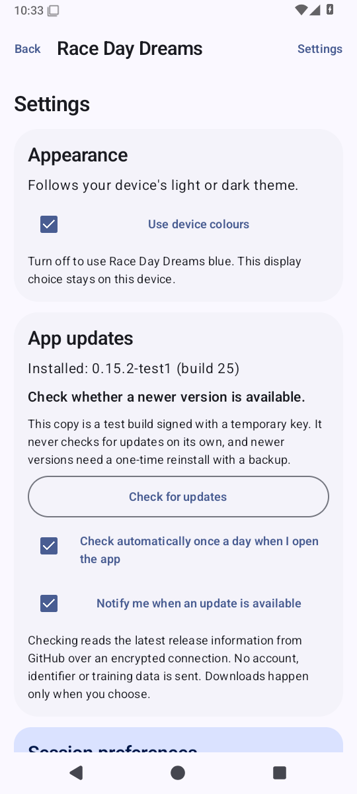</a> <a href="docs/screenshots/storage-management.png">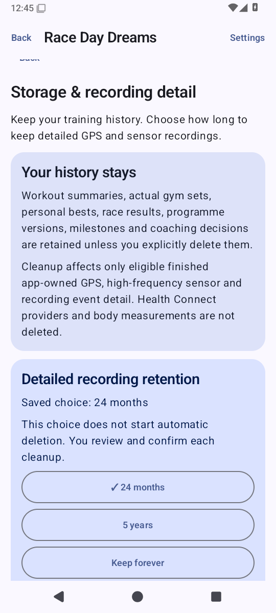</a>

**[Download the latest verified Android test build](https://github.com/mmwiza1/Race-day-dreams/releases/download/development/Race-Day-Dreams-latest-test.apk)** · [Installation](#installation) · [Explore every screenshot](#screenshots)

## Installation

1. Download the APK above, then open it on your Android phone.
2. If Android asks, allow **Install unknown apps** for the browser or file manager you used.
3. Open Race Day Dreams and choose Running, Strength or both. Health permissions are optional.
4. Existing testers: make a **complete backup before upgrading**. Debug-signing keys may differ
   between builds. If Android reports a signing conflict, verify your backup before uninstalling,
   then install and restore it. Uninstalling without a usable backup can lose local data.

Verify the APK with its linked SHA-256 checksum if desired. The release page shows the exact
version, source commit, verified CI run and version-specific APK. These are development builds;
physical GPS, audio, Health Connect/BLE and OEM behaviour still need the [device checklist](TEST_BUILD.md).

## Screenshots

[Explore the full authentic app gallery](docs/screenshots) · [Screenshot sources and integrity](docs/SCREENSHOTS.md) · [Design review and before/after captures](docs/UX_REVIEW.md)

The gallery includes light, dark, large-text, running, gym, technique, recovery, settings and
backup views. Design references are kept separate from actual-build captures.

## For contributors and testers

- [Verification and current delivery evidence](VERIFICATION.md)
- [Architecture](ARCHITECTURE.md) · [Development plan](DEVELOPMENT_PLAN.md) · [Contributor workflow](docs/DEVELOPMENT_WORKFLOW.md)
- [Build and device testing](TEST_BUILD.md) · [Current release notes](https://github.com/mmwiza1/Race-day-dreams/releases/tag/development)
- [Privacy](PRIVACY.md) · [MIT licence](LICENSE) · [Attribution](THIRD_PARTY.md)
- [Dream Route data and licences](docs/DREAM_ROUTES.md)
- [Earlier project overview, release history, gallery and developer details](docs/README_0_12_2_ARCHIVE.md)
- [How the verified rolling download stays current](docs/GITHUB_SHOWCASE.md)

An experimental, unsigned iPhone app now builds from the same shared code; it is not yet
distributed (see [Build and device testing](TEST_BUILD.md)). No cloud sync, mandatory login or
Internet permission is introduced.
