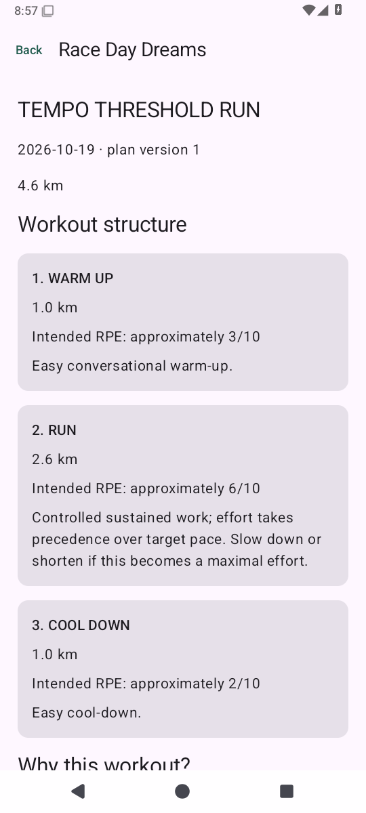
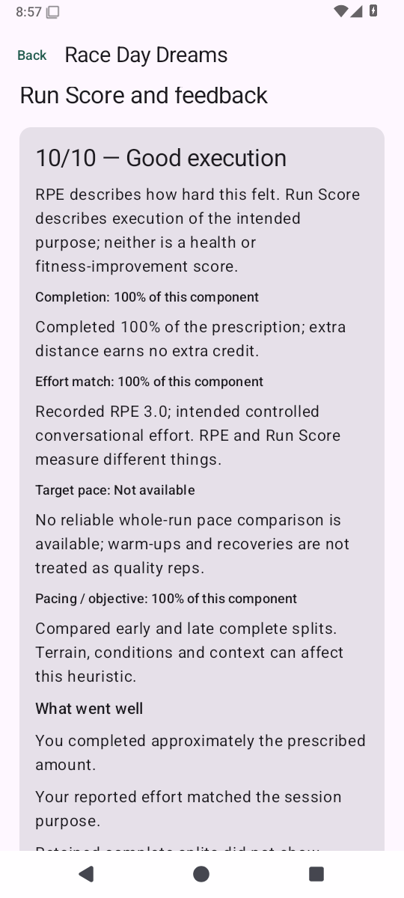
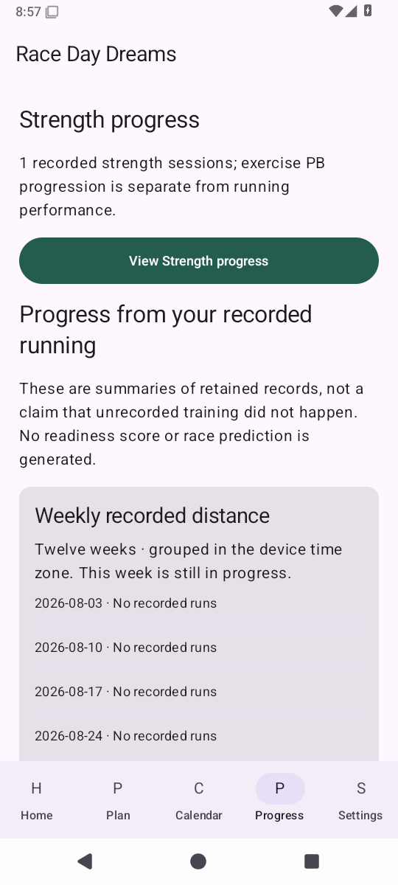
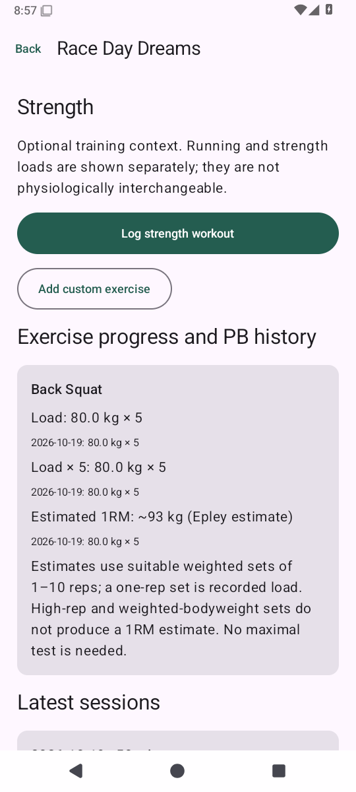

# Race Day Dreams

A free, open-source, account-free Android running companion.

**The app recommends. The runner decides. The plan adapts.**

The app works locally and without Health Connect. It has no Internet permission,
advertising, analytics, subscriptions, backend or LLM dependency.

## Coaching test build — 0.3.0-test1

This branch is an installable evaluation build, **not approved for merging to
main**. It adds original deterministic programmes for 5K, 10K, half marathon,
marathon and general aerobic fitness; availability-aware scheduling; preserved
plan versions; runner-controlled coaching proposals; purpose-based Run Scores
and post-run feedback; optional multi-exercise strength logging, PB history and
estimated 1RM; and transactional schema-4 persistence/backup.

Existing Health Connect import, automatic baseline review/manual fallback,
assessments, activity history, splits/laps/rolling PB quality gates, shoes,
opt-in local reminders and account-free backup remain available.

Plans are created explicitly from Plan. Review your baseline and availability
first. Future sessions are projections, not guarantees. No plan change is forced,
missed mileage is never crammed into later days, and your goal is never silently
changed. This app provides fitness guidance, not medical care.

Health Connect session totals do **not** provide continuous distance samples;
splits and rolling PBs appear only when supported. Missing metrics stay unknown.
GPS recording, maps, Wear OS, advanced multi-week adaptation and multi-evidence
race predictions are pending. See [TEST_BUILD.md](TEST_BUILD.md),
[TRAINING_ENGINE.md](TRAINING_ENGINE.md) and [DEVELOPMENT_PLAN.md](DEVELOPMENT_PLAN.md).

## Install the test APK

Open the latest successful [draft PR #2 workflow](https://github.com/mmwiza1/Race-day-dreams/pull/2/checks).
Download the API-35 artifact containing
`Race-Day-Dreams-0.3.0-test1-debug.apk`, extract it, then install it on your phone.
GitHub artifact downloads require signing in to GitHub. The app itself has no
account requirement. Only use an artifact from a successful run for the intended
branch commit. Debug builds are for evaluation; export a backup before upgrading.

## App Preview

Screenshots are generated from the current Race Day Dreams build using
instrumentation-only demo data. They are real emulator renders, not UI mockups.
Canonical API-35 images and their source fingerprint are in
[docs/screenshots](docs/screenshots). Capture automation commits images only
after all three API jobs pass; see [SCREENSHOTS.md](docs/SCREENSHOTS.md).

| Home | Training plan | Workout detail |
| --- | --- | --- |
|  |  |  |

| Feedback | Progress | Optional strength |
| --- | --- | --- |
|  |  |  |

## Build and tests

Use JDK 17 or 21, Android SDK 36 and Android Studio with Kotlin 2.0 support.
The minimum Android version is API 28. Gradle 8.11.1 / AGP 8.9.2 are pinned.
Set `ANDROID_HOME` or an untracked `local.properties` with your SDK directory.

```sh
./gradlew :domain:check :app:assembleDebug :app:lintDebug :app:assembleDebugAndroidTest
./gradlew :app:connectedDebugAndroidTest
```

The first Android build needs dependency downloads. Pure Java domain tests and
actual schema-DDL checks can also run offline:

```sh
sh scripts/test-domain.sh
python3 scripts/test-schema.py
```

GitHub Actions builds, lints and runs the Android tests on API 28, API 35 and API 36.
Each job uploads a debug APK and device-test report. Exact verified results and
remaining manual checks are recorded in [VERIFICATION.md](VERIFICATION.md).

## Contributing and licensing

Keep calculations independent of Android UI. Preserve planned and actual data,
source identity and runner decisions. No commercial training schedules or GPL
source are incorporated. Original code is [MIT](LICENSE); incorporated libraries
and engineering references are tracked in [THIRD_PARTY.md](THIRD_PARTY.md).

Read [ARCHITECTURE.md](ARCHITECTURE.md), [HEALTH_CONNECT.md](HEALTH_CONNECT.md),
[TRAINING_ENGINE.md](TRAINING_ENGINE.md), [PRIVACY.md](PRIVACY.md),
[TRAINING_SAFETY.md](TRAINING_SAFETY.md), and
[LICENCES_AND_ATTRIBUTION.md](LICENCES_AND_ATTRIBUTION.md).
