# Phase 5A.2 · Strength design review

The comparisons use the published 0.17.0-test1 Android gallery, the original
owner-approved benchmarks, and unmodified captures of the redesigned application.
Click any image to open its original. Both approved Strength references are dark
concepts. Light uses the same layout principles with the application's light palette.
The branch implementation is `3489046d76a0b2c4f46a868d621f8da2aa17ff79`, with final
instrumentation updates in `830e7f6139303fe2122ecf0ecd343f19581c1683` and
`2666557bc27be9e1eceb8df42fa76c78744ee8a1`.

The Before gallery and After fixtures use comparable exercises and recording states
where the published frames allow it. The light historical view is an exact workflow
match. The published gallery lacks a matching dark historical draft or dark completion
frame, so those comparisons use the related dark set logger. Workout values and
viewport dimensions vary. All visible workout values are fixture data.

## Historical workout · light

<table>
<tr><th>Before</th><th>Target</th><th>After</th></tr>
<tr>
<td><a href="../../screenshots/strength-log-previous.png">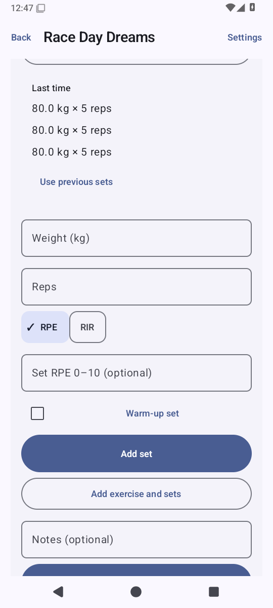</a></td>
<td><a href="../../design-reference/02_strength_dark_lime.png">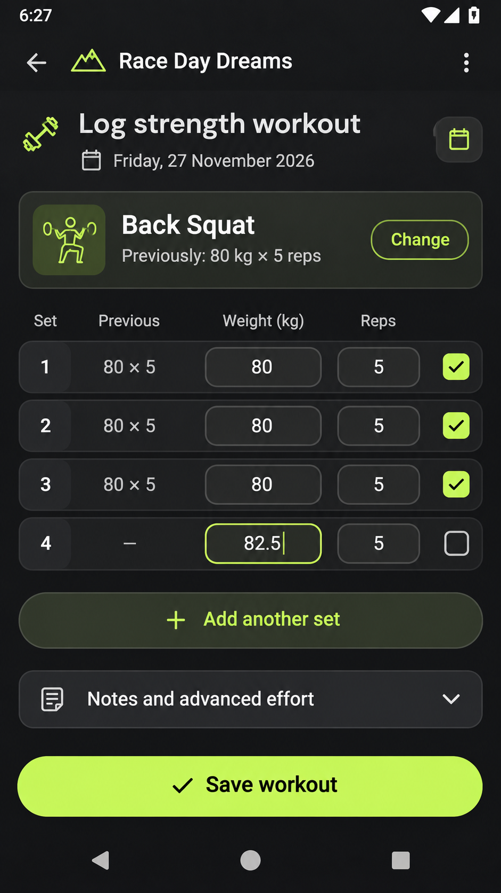</a></td>
<td><a href="after/light/historical-draft.png">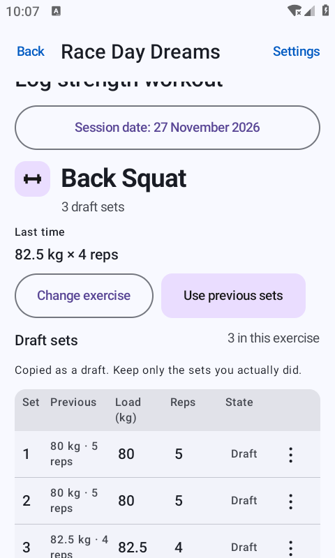</a></td>
</tr>
</table>

## Historical workout · dark

<table>
<tr><th>Before</th><th>Target</th><th>After</th></tr>
<tr>
<td><a href="../../screenshots/gym-workout-dark.png">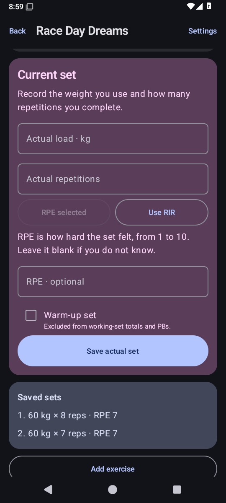</a></td>
<td><a href="../../design-reference/06_strength_dark_violet.png">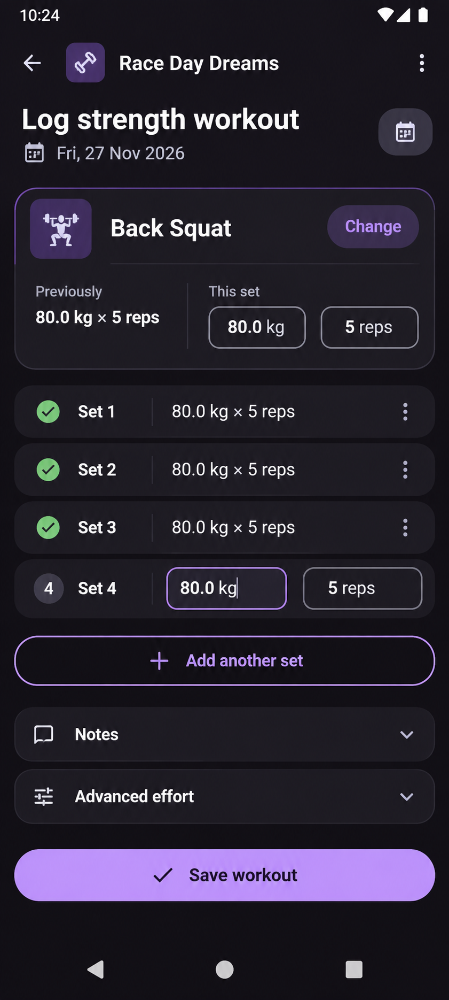</a></td>
<td><a href="after/dark/historical-draft.png">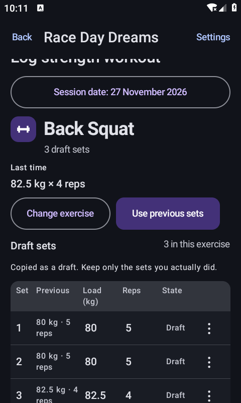</a></td>
</tr>
</table>

## Gym Now · light

<table>
<tr><th>Before</th><th>Target</th><th>After</th></tr>
<tr>
<td><a href="../../screenshots/gym-workout.png">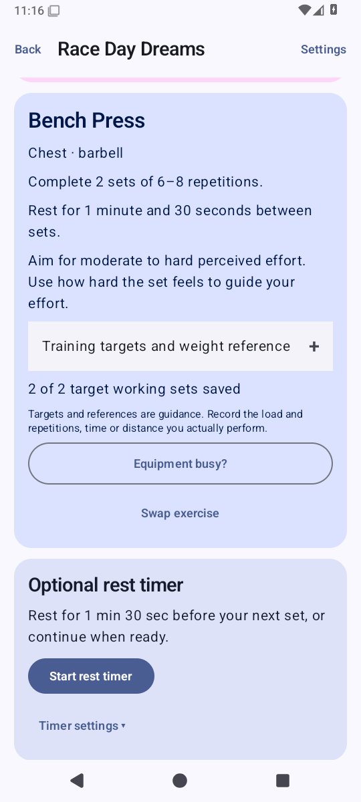</a></td>
<td></td>
<td><a href="after/light/gym-current-set.png">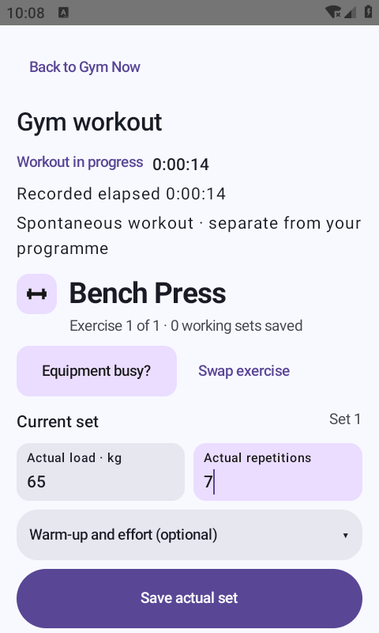</a></td>
</tr>
</table>

## Gym Now · dark

<table>
<tr><th>Before</th><th>Target</th><th>After</th></tr>
<tr>
<td></td>
<td></td>
<td><a href="after/dark/gym-saved-set.png">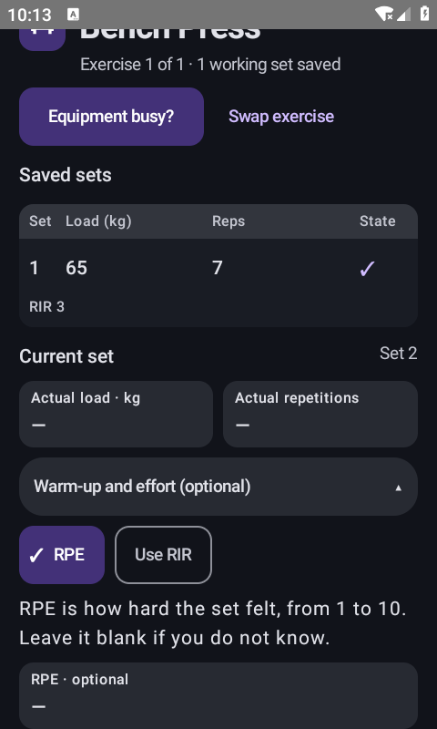</a></td>
</tr>
</table>

## Planned workout · light

<table>
<tr><th>Before</th><th>Target</th><th>After</th></tr>
<tr>
<td></td>
<td></td>
<td><a href="after/light/gym-planned-set.png">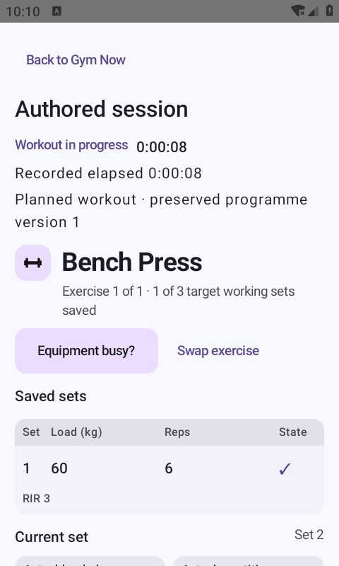</a></td>
</tr>
</table>

## Planned workout · dark

<table>
<tr><th>Before</th><th>Target</th><th>After</th></tr>
<tr>
<td></td>
<td></td>
<td><a href="after/dark/gym-planned-set.png">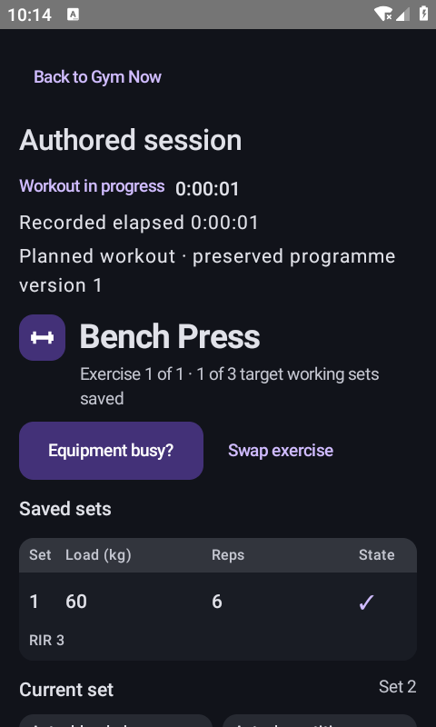</a></td>
</tr>
</table>

## Recorded workout review · light

<table>
<tr><th>Before</th><th>Target</th><th>After</th></tr>
<tr>
<td><a href="../../screenshots/gym-workout-saved.png">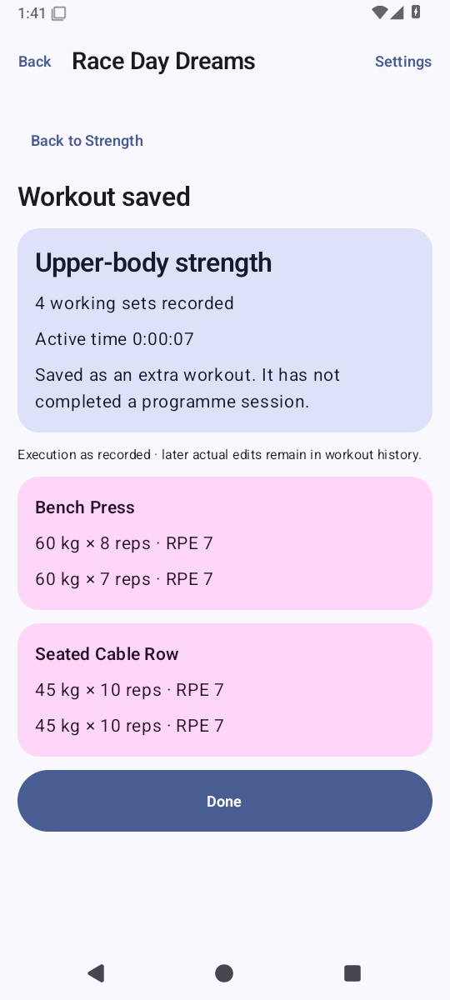</a></td>
<td></td>
<td><a href="after/light/gym-completion.png">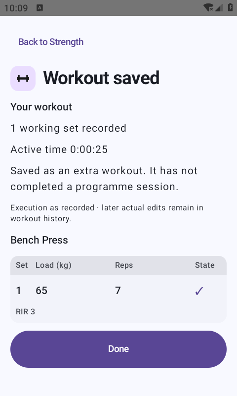</a></td>
</tr>
</table>

## Recorded workout review · dark

<table>
<tr><th>Before</th><th>Target</th><th>After</th></tr>
<tr>
<td></td>
<td></td>
<td><a href="after/dark/gym-completion.png">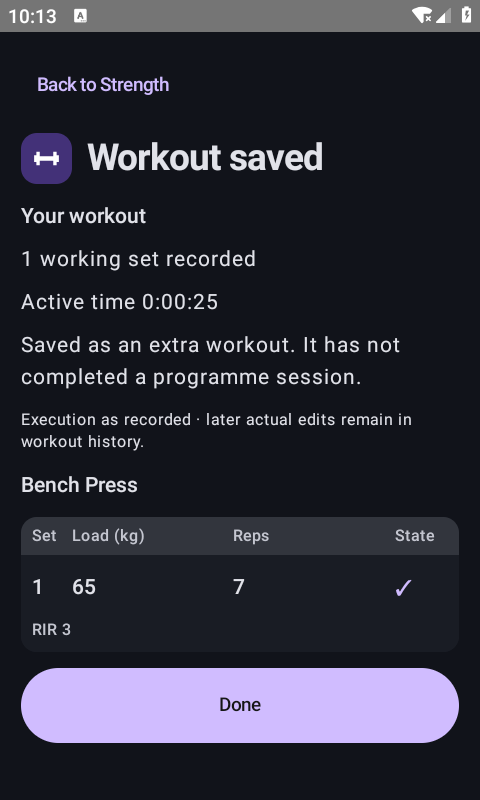</a></td>
</tr>
</table>

## Accessibility and interaction evidence

- [320dp historical draft at 200%](after/large/historical-draft.png) and [the save action](after/large/historical-save.png).
- [320dp Gym Now entry at 200%](after/large/gym-current-set.png) and [the saved set](after/large/gym-saved-set.png).
- [Keyboard open while entering weight](after/large/strength-keyboard.png) and [the updated workout in history](after/large/strength-recorded-table.png).
- [Invalid entry beside Add set](after/light/strength-entry-error.png) and [early planned-session confirmation](after/light/gym-start-early.png).
- [Historical source reopened after editing](after/light/historical-reopened.png) and [the save acknowledgement](after/dark/historical-completion.png).

## Review against the benchmark

| Criterion | Historical logging | Gym Now and planned logging | Saved workout review |
| --- | --- | --- | --- |
| Task clarity | The exercise, date, last performance and next set establish what the athlete is logging. | Exercise position and working sets saved establish where the athlete is in the session. A planned session names its programme link. | The acknowledgement says what was recorded and whether it completed a programme session. |
| Visual hierarchy | The exercise leads. Aligned previous and current measurements make each draft easy to scan. | The entry and save action lead. Rest and programme targets retain their own roles. | Sets and their measurements appear in columns under each exercise. |
| Interaction efficiency | Copy the last workout's sets as drafts, or tap a row to edit. Row menus retain duplicate and remove. | Enter real values and save a set. Compact switch and swap actions stay distinct. | The completion action exits to the existing destination. The history flow reopens the same source workout for edits. |
| Progressive disclosure | Session details, warm-up and effort remain available when needed. | Rest, earlier sets and optional effort keep their own headings. | The set table shows recorded values without editable input controls. |
| Consistency | Neutral surfaces, violet emphasis and activity typography carry into set entry. | Planned, open and paused workouts reuse the shared workspace. | The same table renders in completion and the recorded-history review. |
| Visual quality | The new page replaces fields and single-line summaries with a dedicated logging workspace. | The open layout gives the next set substantially more space than the published tinted panel. | A distinct success heading and structured values make the saved session easier to scan. |
| Accessibility | Editing and measurement announcements are tested. Rows stack at large text. | Labelled, touch-sized inputs and separate action treatments remain legible in both themes. | Set state is available in semantics as well as in the visible checkmark. |
| Functional integrity | Distinct set identifiers and unchanged date, duration and notes were checked after saving. | Planned association, working-set counts, pause and resume, and duplicate completion were checked. | Saved load, repetitions, effort and original workout identity were confirmed after reopening. |

The renders are substantially clearer than the published layout. Their compact set
data, prominent exercise names and single prominent action per task follow the
benchmarks and give the three flows a purpose-built fitness interface. Removing large
containers, redundant explanations and visually equal actions improves the density.
The visual hierarchy is credible alongside dedicated workout trackers. Owner visual
approval remains pending.

The references put editable fields in every row. This implementation uses a compact
current-set editor and opens a historical row in that editor on tap. Gym Now keeps
saved actuals visible independently of the next entry. Planned targets and source
dates remain distinct. The app preserves its own navigation, dynamic palette and
selectable Strength accent. At 200%, labelled values stack vertically and later
actions can require scrolling. The concepts show standard text. The existing app bar can abbreviate the app name at 320dp and 200%.

## Verification scope

The debug app, instrumentation APK and debug lint passed. The pinned formatter
passed for changed Kotlin files in its scope. SQLite JVM tests passed for Gym
execution (21), workout association (19) and backup/restore (8). All 14 targeted API 28
scenario and theme combinations passed after focused retests (six light, five dark,
three at 200%). They covered historical copy and save, draft editing and reopening,
bodyweight/time/distance measurements, Gym Now pause and resume, prescribed
versus entered sets, and duplicate planned completion. The compact renders use
normal text around 360dp and dark at 320dp with 200% text. All captured values
come from test sessions on Android. Native iOS, manual TalkBack/VoiceOver and
physical devices remain unverified. The full matrix belongs to integration.
